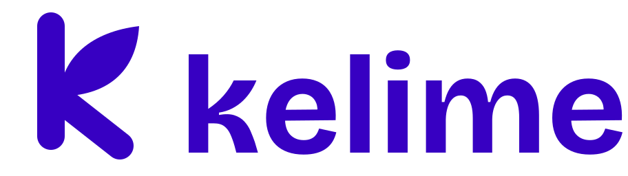
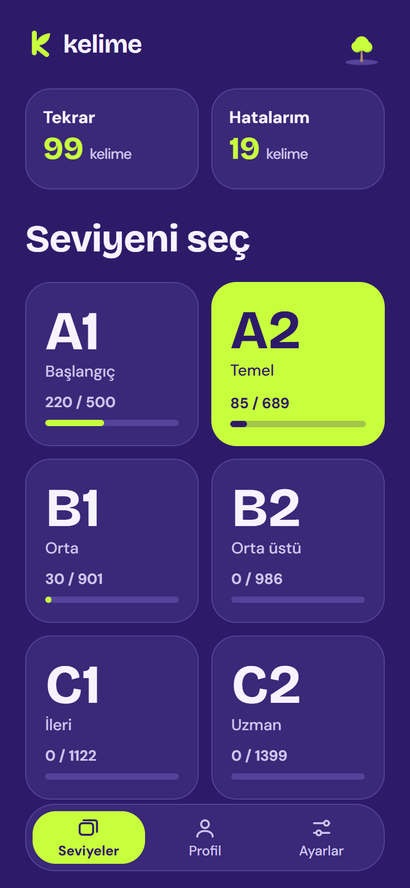
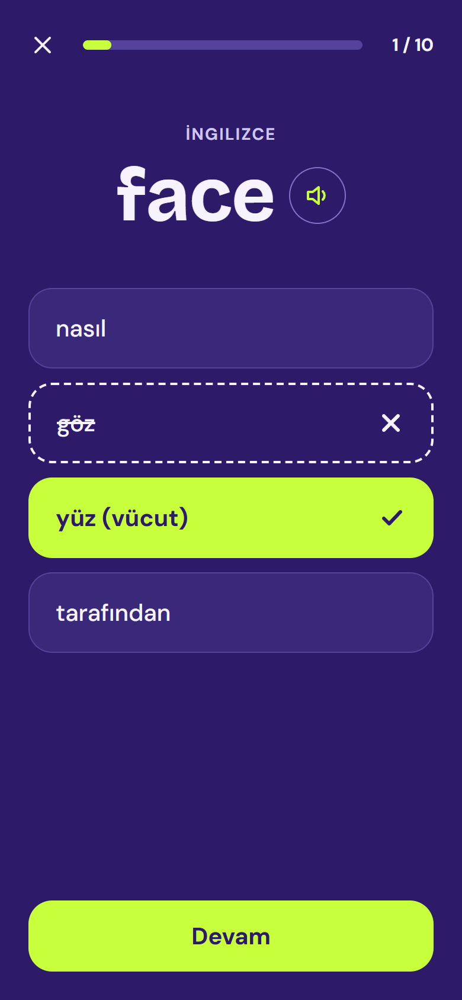
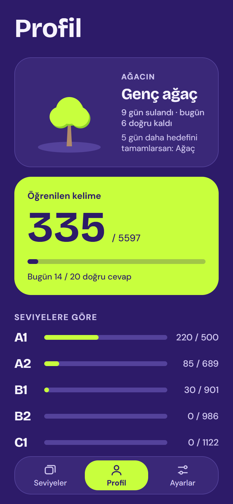
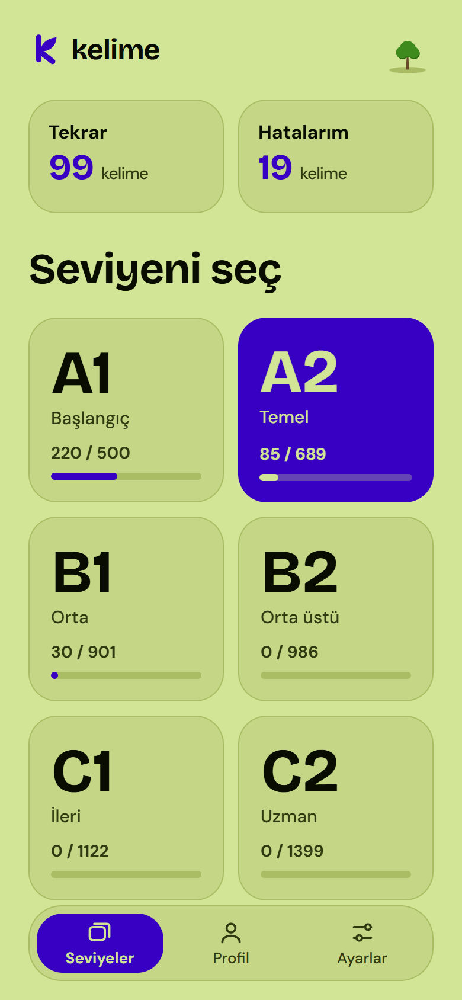
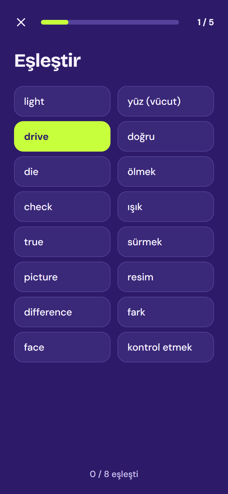
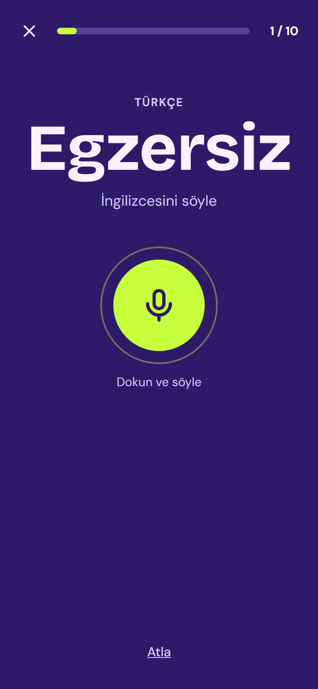
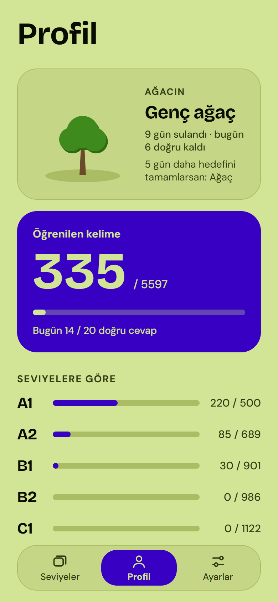
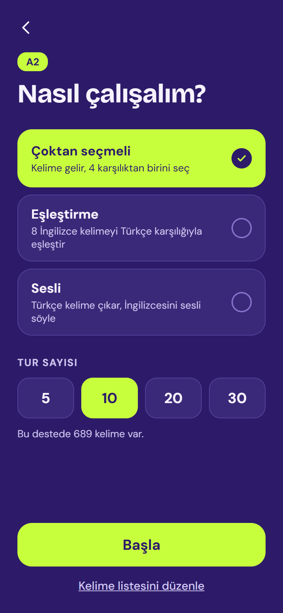
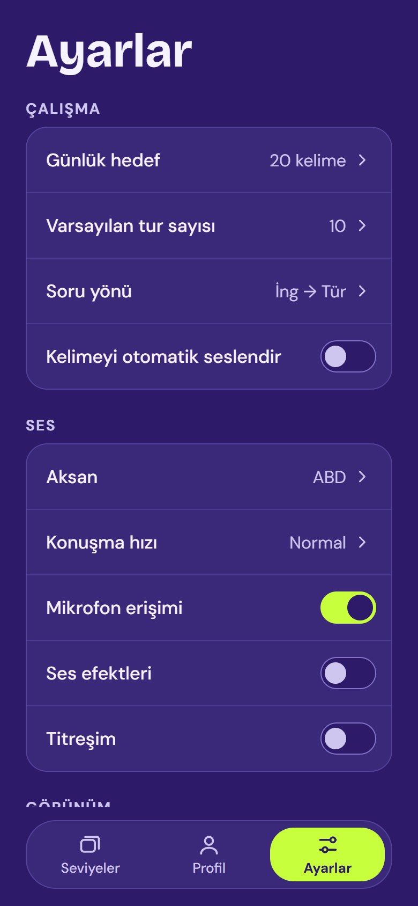

<p align="center">
  <picture>
    <source media="(prefers-color-scheme: dark)" srcset="design/logo/kelime-lockup-dark.svg">
    
  </picture>
</p>

<p align="center"><b>Türkçe arayüzle İngilizce kelime öğren.</b><br>
A1'den C2'ye 5.600 kelime · aralıklı tekrar · sesli çalışma · büyüyen bir ağaç</p>

<p align="center">
  
  
  
  
</p>

**kelime**, İngilizce kelime dağarcığını her gün birkaç dakikayla büyütmek isteyenler için yapılmış, tamamen Türkçe
bir mobil uygulama. Oxford 5000 listesindeki kelimeler seviyelere ayrılmış; her kelimenin Türkçe karşılıkları
elden geçirilmiş, eş anlamlılar ve aynı Türkçe karşılığa sahip kelimeler (ör. *hour* / *clock* → "saat") ayırt ediliyor.

Hesap açmak yok, internet gerekmiyor, reklam yok. Tüm ilerlemen telefonunda kalır; istersen tek dokunuşla yedekleyip
başka telefona taşırsın.

> 💻 **Bilgisayarda da var:** Windows sürümü için [kelime-pc](https://github.com/omerfarukoktay112-max/kelime-pc).
> Telefondaki yedek dosyası bilgisayara, bilgisayardaki telefona yüklenebilir.

## Neler var?

### Üç çalışma modu
| Çoktan seçmeli | Eşleştirme | Sesli |
| :---: | :---: | :---: |
|  |  |  |
| Kelime gelir, 4 seçenekten doğru karşılığı bul. Yön İng → Tür ya da Tür → İng olabilir. | 8 İngilizce kelimeyi Türkçe karşılıklarıyla eşleştir. | Türkçe kelimeyi gör, İngilizcesini sesli söyle; telaffuzun tanınır. |

### Unutturmayan tekrar sistemi
- Doğru bildiğin kelime **1, 3, 7, 14, 30 ve 60 gün** sonra karşına yeniden çıkar.
- Bir kelime **farklı günlerde 4 kez** doğru bilinince "öğrenildi" sayılır, ama tamamen kaybolmaz; seyrek aralıklarla sorulmaya devam eder.
- Ana ekrandaki **Tekrar** kartı tüm seviyelerden zamanı gelen kelimeleri, **Hatalarım** kartı son yanlış yaptığın kelimeleri tek yerde toplar.

### Ağacını büyüt
| Profil | Açık tema |
| :---: | :---: |
|  |  |

Günlük hedefini tamamladığın her gün ağacın büyür: **tohum → filiz → fidan → genç ağaç → ağaç → çiçekli ağaç → meyveli ağaç**.
Ara verirsen ağaç küçülmez, sadece susar; bir sonraki hedefinde yeniden canlanır. Seri kaybetme stresi yok.

### Ve diğerleri
- ABD / İngiltere aksanıyla seslendirme, 3 farklı hız
- Bildiğin kelimeleri listeden çıkarma (pasif kelimeler)
- Koyu ve açık tema (logo da temaya göre değişir), yazı boyutu
- Ses efektleri ve titreşim
- Yedekle / geri yükle

<details>
<summary>Diğer ekranlar</summary>
<p>
  
  
</p>
</details>

## Denemek

### Android
[Releases](../../releases/latest) sayfasından `kelime.apk` dosyasını indirip telefona kur. Android, bilinmeyen kaynaklardan yükleme izni isteyebilir.

### Windows
[kelime-pc Releases](https://github.com/omerfarukoktay112-max/kelime-pc/releases/latest) sayfasından `kelime_x.y.z_x64-setup.exe`
dosyasını indirip çalıştır (2 MB, yönetici izni istemez). Aynı kelimeler ve tekrar sistemi; klavye kısayolları ve sistem tepsisi
desteğiyle, arkada açıkken bilgisayarı yormayacak şekilde yapıldı. Ayrıntılar: [kelime-pc](https://github.com/omerfarukoktay112-max/kelime-pc).

### iPhone / iPad
Ücretli bir Apple geliştirici hesabı olmadığı için uygulama App Store'da ya da hazır kurulum dosyası olarak yok.
Bir Mac'in varsa kendin derleyip deneyebilirsin:

**A) Kendi iPhone'una kur (ücretsiz Apple kimliğiyle)**
1. Mac'e Xcode (App Store) ve Node.js 20+ kur.
2. Projeyi indir, klasörde `npm install` çalıştır.
3. `app.json` içindeki `ios.bundleIdentifier` değerini sana özgü bir şeyle değiştir (ör. `com.adin.kelime`).
4. iPhone'u kabloyla bağla ve çalıştır: `npx expo run:ios --device --configuration Release`
5. Xcode imzalama için Apple kimliğini isterse: Xcode > Settings > Accounts'tan ekle, `ios/Kelime.xcworkspace` içinde Signing & Capabilities'de "Team" olarak seç.
6. iPhone'da Ayarlar > Genel > VPN ve Cihaz Yönetimi'nden geliştiriciye güven.

Ücretsiz hesapla kurulan uygulama 7 gün sonra açılmaz; aynı komutla yeniden kurman yeterli.

**B) Mac'teki iOS Simülatöründe dene (Apple hesabı gerekmez)**
`npx expo run:ios` komutu uygulamayı simülatörde açar. Ya da ücretsiz bir Expo hesabıyla
`npx eas-cli@latest build --profile ios-simulator --platform ios` çalıştırıp çıkan `.app` dosyasını simülatöre sürükle.

## Geliştirme

```bash
npm install
npx expo start          # aynı Wi-Fi'deki telefonda QR kodu Expo Go ile okut
npm run typecheck
```

> **Sesli mod:** konuşma tanıma (`expo-speech-recognition`) yerel bir modül olduğu için Expo Go'da çalışmaz;
> orada sesli mod otomatik olarak "yazarak cevapla"ya geçer. APK'da ya da `npx expo run:android` / `run:ios` ile
> kurulan sürümde mikrofonla çalışır.

### APK oluşturma
Ücretsiz bir Expo hesabı yeterli. Derleme Expo sunucularında yapılır, bilgisayarda Android SDK gerekmez:

```bash
npx eas-cli@latest login
npx eas-cli@latest build --profile apk --platform android
```

Derleme bitince verilen bağlantıdan `.apk` dosyasını indirip GitHub Releases'e yükleyebilirsin.

## Kelime verisi

Asıl kaynak: **`../ingilizce_kelimeler.json`** (proje klasörünün bir üstünde). Uygulama bunun kopyasını okur:
`assets/data/words.json`. Kaynak dosyayı düzenledikten sonra kopyayı güncelle:

```bash
npm run words:sync
```

```json
{
  "A1": [ { "word": "house", "turkish": ["ev"], "meaning_groups": ["ev"], "usage_note": "isteğe bağlı" } ],
  "A2": [ ... ], "B1": [ ... ], "B2": [ ... ], "C1": [ ... ], "C2": [ ... ],
  "_ortak_anlamlar": { ... },
  "_kaynak": { ... }
}
```

| Alan | Açıklama |
| --- | --- |
| `word` | İngilizce kelime. Küçük harfli hali kalıcı kimliktir; ilerleme buna bağlıdır, seviye değişse de korunur |
| `turkish` | Türkçe karşılıklar; ilki ana karşılıktır |
| `meaning_groups` | Ortak anlam grubu. Aynı gruptaki kelimeler eş anlamlı sayılır: birbirine çeldirici olmaz, sesli modda hepsi doğru kabul edilir |
| `usage_note` | Kelime listesinde gösterilen kısa not |

- Ana Türkçe karşılığı başka bir gruptaki kelimeyle aynıysa (hour/clock → "saat") ekranda bağlam etiketli grup adı gösterilir: "saat (süre)", "saat (cihaz)".
- Anlamı çakışan kelimeler aynı soruda çeldirici olarak ya da aynı eşleştirme tahtasında birlikte çıkmaz.
- `_ortak_anlamlar` uygulama tarafından kullanılmaz; gruplar `meaning_groups` alanından okunur.
- Okuma kodu: `src/data/words.ts`.

## Yapı

```
src/
  app/                      Ekranlar (Expo Router, dosya = rota)
    index.tsx               Ana ekran: Tekrar, Hatalarım, seviyeler
    level/[level]/index.tsx Çalışma ayarı (mod + tur sayısı). level = A1…C2 | review | mistakes
    level/[level]/words.tsx Kelime listesi (aktif/pasif)
    study/quiz.tsx          Çoktan seçmeli
    study/match.tsx         Eşleştirme
    study/speak.tsx         Sesli
    study/result.tsx        Tur sonu özeti
    profile.tsx             Ağaç ve ilerleme
    settings.tsx            Ayarlar, yedekleme
  components/               Txt, Icon, Tree, TabBar, ui (Screen, butonlar, Switch, ProgressBar)
  data/                     Kelime tipleri ve JSON yükleyici
  lib/                      srs (aralıklı tekrar), tree (ağaç), session (kelime seçimi), speech, feedback (ses/titreşim), backup
  store/                    AsyncStorage'da kalıcı durum: ilerleme, pasif kelimeler, ayarlar, ağaç
  theme/                    Koyu/açık tema renkleri, fontlar
assets/sounds/              Doğru/yanlış ses efektleri
```

## Kaynaklar ve lisans

- Uygulama kodu: **MIT** (bkz. [LICENSE](LICENSE)).

- Türkçe anlamlar: [tema4p/english-vocabulary](https://github.com/tema4p/english-vocabulary) (Oxford 5000 Türkçe listesi), **CC BY-NC 4.0**. Anlamlar bu projede gözden geçirilip düzenlendi. Bu lisans nedeniyle kelime verisi ticari amaçla kullanılamaz.
- Fontlar: Bricolage Grotesque ve DM Sans (SIL Open Font License, `@expo-google-fonts`).
- Ses efektleri bu proje için üretildi.
